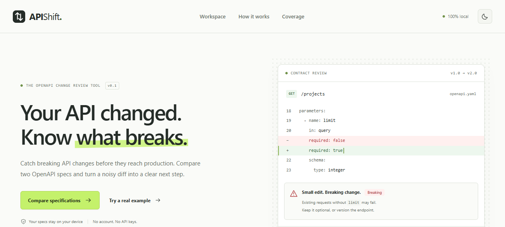
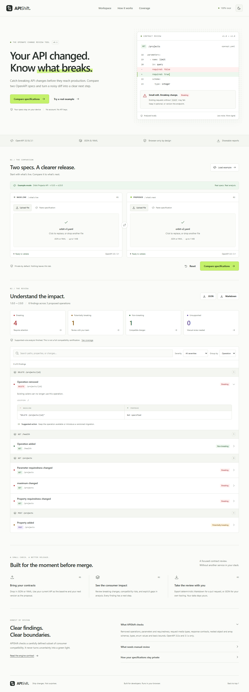
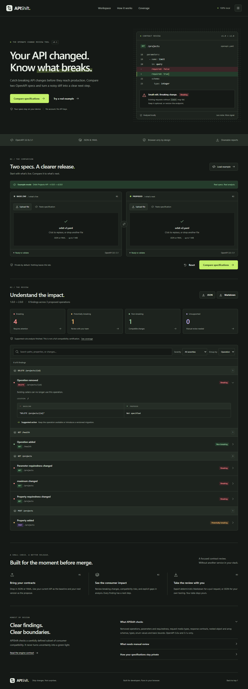

# APIShift

**Catch breaking API changes before they reach production.**

APIShift compares two OpenAPI 3.0.x / 3.1.x specifications and reports which changes can break existing API consumers — computed entirely in your browser, with explicit boundaries around what the analysis does *not* know.

<table>
  <tr>
    <td></td>
  </tr>
  <tr>
    <td></td>
  </tr>
  <tr>
    <td></td>
  </tr>
</table>

## The problem

Publishing an API change without checking consumer compatibility is how red diffs become outages. Existing tools either require accounts, upload your contracts to a server, or print a wall of JSON that nobody reviews before merging. APIShift takes the position that a *contract review* should answer one question first: **what breaks, and what do I do about it?**

- **Baseline** — your live API.
- **Proposed** — the next version.
- Findings are classified as **breaking**, **potentially breaking**, **non-breaking**, or **unsupported** (analysis gaps are reported, never hidden behind a green check).

## Features

- Load two OpenAPI specifications as JSON or YAML (file upload, drag-and-drop, or paste), labeled **BASELINE** and **PROPOSED**
- Built-in working example — no files needed
- Version validation: OpenAPI 3.0.x and 3.1.x; Swagger 2.0, OpenAPI 3.2/4.0 and malformed documents are rejected with clear messages (no partial "clean" reports)
- Consumer-oriented compatibility checks with before/after values, explanation and suggested action per finding
- Summary counters, text search, severity filters, grouping by operation or severity, useful empty states
- Deterministic JSON and Markdown exports (byte-identical for identical inputs — suitable for review pipelines)
- Swap/reset inputs with automatic invalidation of stale results and an undo option
- Light/dark theme following the system preference
- Fully keyboard accessible and screen-reader friendly; zero external requests after load

### Explicit limitations

APIShift is deliberately **not** a full OpenAPI validator or a complete JSON Schema satisfiability checker. The following are reported as `unsupported` findings rather than guessed at:

- Compositions (`allOf`, `oneOf`, `anyOf`), conditionals (`if`/`then`/`else`, `not`), `pattern`, `format`, `additionalProperties`, `unevaluatedProperties`, `uniqueItems`, `readOnly`/`writeOnly` effects and other advanced JSON Schema semantics
- Security schemes, servers, callbacks, webhooks, links, headers, encoding and serialization options
- Remote (`http(s)://…`) or cross-file references — never fetched; recursive/circular references are rejected
- OpenAPI 3.1 `nullable` (use a `null` type union in 3.1) and 3.0 boolean schemas
- Runtime behavior, content negotiation, discriminator routing and authentication compatibility are out of scope

An input gate documents the supported subset in-app; the full rule table lives in the [engine contract](public/docs/architecture.md). Supporting fewer rules with explicitly reported uncertainty is a design decision, not a roadmap shortcut.

## Architecture

```
src/
├── engine/            Pure, deterministic TypeScript (no React, no browser APIs)
│   ├── types.ts       Typed internal model, severity taxonomy, processing limits
│   ├── parse.ts       YAML/JSON parsing, structure validation, bounded #/ reference resolution
│   ├── compare.ts     Consumer-semantics comparison rules → ordered findings
│   ├── stable.ts      Canonical JSON (stable ordering, stable IDs)
│   └── report.ts      JSON/Markdown exports (HTML-escaped content)
├── compare.worker.ts  Comparison entry point inside a dedicated Web Worker
├── components/        Reusable accessible UI primitives
├── samples.ts         Bundled example specifications (Vite inlined)
└── App.tsx            Input, worker lifecycle, filters, exports
```

**Comparison engine.** Each document is parsed with the `yaml` library (core schema, aliases rejected), size- and node-bounded, and checked for the analyzed structure before comparison begins — an invalid element fails the entire run instead of producing a partial report. JSON Pointers (`#/…` same-document refs) are resolved safely with URI decoding, cycle detection and step budgets; external references fail immediately.

Compatibility is defined from the **existing consumer's perspective**: a compatible change must not invalidate previously accepted requests nor change previously guaranteed responses. That yields the direction rule: request narrowing breaks, response widening breaks, and each comparator inherits this rule recursively — objects, arrays, enums, `null` type unions (3.1), `nullable` (3.0), numeric/length/item bounds and requiredness.

Findings are sorted deterministically and carry collision-free IDs derived from `operation|location|rule` (URI-encoded), so identical inputs produce identical reports — no timestamps, no array-index identifiers.

**Isolation.** Parsing and comparison run in a dedicated Web Worker guarded by an 8-second watchdog; editing, swapping or resetting inputs terminates pending work. Rendered values go through JSON canonicalization → text rendering (no `innerHTML`); Markdown exports HTML-escape all specification-derived strings.

**Privacy.** No network calls, analytics, cookies, or storage. Specifications live only in tab memory.

## Getting started

```bash
pnpm install          # pnpm 12 recommended (npm/yarn work too)
pnpm dev              # dev server with HMR
pnpm test             # Vitest: comparison rules + parser regressions (99 tests)
pnpm test:e2e         # Playwright: real browser workflows (14 tests, 2 viewports)
pnpm test:e2e --ui    # interactive Playwright runner
pnpm lint             # ESLint (React hooks + core-web-vitals rule set)
pnpm typecheck        # TS strict for app and tests
pnpm build            # production bundle → dist/
pnpm preview          # serve dist/ locally (checks a11y, privacy and error handling)
```

First Playwright run needs a browser once: `pnpm exec playwright install chromium`.

### CI

GitHub Actions runs on every push/PR: lint → typecheck → Vitest → production build → Playwright against the built bundle (`.github/workflows/ci.yml`).

## Deployment (Cloudflare Pages, free tier)

Static zero-backend deployment:

1. Push this repo to GitHub
2. Cloudflare Pages → "Connect to Git"
3. Build settings: **Framework preset: Vite**, build `pnpm build`, output `dist`
4. Done — `public/_headers` ships a restrictive CSP (`connect-src 'none'`) that enforces the "no data leaves your browser" claim at the origin level

Vercel or GitHub Pages work equally well with the same `dist` output; only the dashboard/headers file is Cloudflare-specific.

## Roadmap

- [x] Core engine: operations, parameters, bodies, responses, nested schemas
- [x] Deterministic JSON/Markdown exports with stable IDs
- [x] Worker isolation, watchdog and input invalidation
- [x] Responsive, accessible, light/dark UI
- [ ] `readOnly`/`writeOnly` direction-aware requiredness
- [ ] Composition awareness (skip sub-schema checks *under* a parent node — keep "unsupported" certification)
- [ ] `format`-derived type assertions (date-time, int64, uuid)
- [ ] Externally hosted verdict badges (PR comments via GitHub App — still no spec uploads)
- [ ] Configurable policies (default: report-only)

## Contributing

Issues and PRs welcome — especially counter-examples where the engine disagrees with your intuition. Concretely:

1. Fork + branch from `main`
2. Add positive **and** negative test fixtures in `tests/engine.test.ts` when touching a rule; keep runtime (not compile-time) guarantees exemplified in `tests/limits.test.ts`
3. `pnpm test && pnpm lint && pnpm typecheck && pnpm test:e2e` locally
4. Keep PRs demo-first: a failing input + the expected classification beats prose

The comparison rules are the product, so rule changes without test coverage are not merged. If you want to add a rule outside the supported subset, raise the boundary explicitly (see the [engine contract](public/docs/architecture.md)) so it is documented rather than silently extended.

## License

[MIT](LICENSE) — chosen because it maximizes reuse for teams embedding the engine in their own review pipelines and keeps the project approachable for PRs. The UI is Firefox-tested; engine code is dependency-light (`react`, `yaml`, `tailwindcss`) and audit-clean.

If you use APIShift inside a larger product, a note in your README is appreciated but not required.
